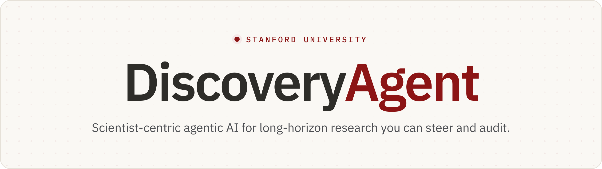

<p align="center">
  <picture>
    <source media="(prefers-color-scheme: dark)" srcset="docs/assets/header-dark.png">
    <source media="(prefers-color-scheme: light)" srcset="docs/assets/header-light.png">
    
  </picture>
</p>

<p align="center">
  <a href="#quick-start"><strong>Install</strong></a> &nbsp;·&nbsp;
  <a href="#see-it-in-action">Demo</a> &nbsp;·&nbsp;
  <a href="#how-it-works">How it works</a> &nbsp;·&nbsp;
  <a href="docs/user-guide.md">User guide</a> &nbsp;·&nbsp;
  <a href="#paper">Paper</a>
</p>

<h3 align="center">Agents run the research. You decide what's worth asking.</h3>

DiscoveryAgent is a multi-agent AI system for semi-autonomous scientific research. Give it your data and a research objective, and it carries out iterative investigations: exploring your data, connecting findings to the scientific literature, performing computational analyses, and developing new hypotheses.

Within a hypothesis, a coordinated team of specialized agents plans the investigation, synthesizes the literature, writes and executes analyses, and critiques intermediate findings. Between hypotheses, you select, refine, or replace the next direction. Research unfolds in rounds, each carrying forward the evidence and context of the last, and an Audit Agent lets you trace any claim back to the code and data behind it.

DiscoveryAgent runs locally on your Mac as a persistent research workspace.

## See it in action

https://github.com/user-attachments/assets/0ce3b30c-fe8b-4726-8b28-6bfcd3c17de1

## Why DiscoveryAgent

<table>
  <tr>
    <td width="33%" valign="top">
      <sub><code>TRANSPARENCY</code></sub><br>
      <strong>The research history is an output</strong><br><br>
      Each round's queries, code, reports, and figures stay in your project, so the work behind a finding remains available to inspect.
    </td>
    <td width="33%" valign="top">
      <sub><code>AUDITABILITY</code></sub><br>
      <strong>A record you can interrogate</strong><br><br>
      No one can read every line of agent-written code before each decision. The Audit Agent navigates the investigation for you: find where a claim came from, inspect the analysis behind it, or probe it with a follow-up.
    </td>
    <td width="33%" valign="top">
      <sub><code>STEERABILITY</code></sub><br>
      <strong>Direct the science, not the keystrokes</strong><br><br>
      You step in at hypothesis boundaries to choose, edit, or replace the next direction while agents carry out the analyses. Your attention goes where judgment matters.
    </td>
  </tr>
</table>

## Quick Start

> **Requirements:** an Apple Silicon Mac running macOS 15 or newer, and an Anthropic API key.<br>
> The installer manages the application runtime and dependencies for you. Paperclip authentication for literature research is handled during setup.

**1. Install**

```bash
curl -fsSL https://github.com/evangorrell/DiscoveryAgent-app/releases/latest/download/install.sh | sh
```

**2. Launch.** Open a new Terminal window and run:

```bash
discoveryagent
```

This starts the local DiscoveryAgent app and opens it in your browser. On first launch, follow the Terminal prompts for your project folder, Anthropic API key, and Paperclip sign-in; prompts for credentials that are already configured are skipped. Keep Terminal open while using the app, and press **Ctrl+C** there when finished.

**3. Run your first investigation**

1. **Add your data.** Register the files or folders you want DiscoveryAgent to work with.
2. **Create a project.** Select your data, provide a research objective, and add relevant scientific context.
3. **Run the initial exploration.** DiscoveryAgent works best when it can first explore your data and get oriented. Start **Round 0** and review its findings in **Round Workspace**.
4. **Choose the next direction.** Open **Hypothesis Studio**, initialize the workspace, discuss, edit, and revise candidate hypotheses, and select one for the next round.

## How It Works

<p align="center">
  <code>Data &amp; context</code> → <code>Explore</code> → <code>Develop hypotheses</code> → <code>Investigate</code> → <code>Review &amp; audit</code> → <code>Continue</code>
</p>

| Step | What happens |
| --- | --- |
| **Explore & steer** | An exploratory round builds an understanding of your research problem. At each round boundary, the hypothesis agent proposes candidates grounded in everything found so far; you accept, edit, or replace them. |
| **Investigate** | Agents launch a focused research round on the selected hypothesis and end it with a round report. |
| **Audit** | Ask the Audit Agent why an analysis was run, where a number came from, or which script produced a figure. It works from the project's reports, code, and supporting evidence, not just the summary. |
| **Continue** | Choose the next direction. Each round builds on the evidence and context of the last. |

## App Overview

| Area | What you can do |
| --- | --- |
| **Projects (Home)** | Create new projects and manage existing investigations. |
| **Data (Home)** | Register local files and folders, then choose which projects can access them. |
| **Hypothesis Studio** | Generate, discuss, revise, and select candidate hypotheses. |
| **Round Workspace** | Follow research activity and browse each round's code, reports, figures, and outputs. |
| **Reports** | Read a summary or full research round report and inspect supporting analyses and figures. |
| **Audit Agent** | Ask questions about the investigation and inspect its reports, code, and supporting evidence. |
| **Skills** | Import project-specific skills for execution agents. |

## Agent System

DiscoveryAgent coordinates several agent roles around an investigation:

| Role | Responsibility |
| --- | --- |
| **Director** | Guides the sequence of research queries within a round. |
| **Research & execution agents** | Gather information from the literature and carry out analyses. |
| **Review agent** | Evaluates intermediate findings and helps refine the investigation. |
| **Hypothesis agents** | Propose possible next directions at round boundaries. |
| **Memory & reporting** | Retain context across rounds and assemble results for review. |

In the app, you set the objective, make data available, select hypotheses, and decide when to continue. Agents produce reports, code, and figures so you can examine how each result was reached.

> [!NOTE]
> For more details on the technical architecture, evaluation, and scientific methodology, see the accompanying [paper](#paper).

## Skills

Skills extend the execution agent with instructions, workflows, and supporting resources. Import a `SKILL.md`, `.skill`, or `.zip` package into a project's **Skills** page. Each research round captures its skill configuration, so later imports do not change a round already underway.

See [Using Skills](docs/user-guide.md#using-skills) for package format and round behavior.

## Configuration

Choose supported Anthropic **Reasoning** and **Execution** models in a project's **Advanced Settings**. When starting a round, review the query budget and whether **Deep Research** and **Web Search** are enabled. Resuming an interrupted round keeps its recorded configuration.

An Anthropic key entered at launch is used only for that session and is not saved by DiscoveryAgent. Paperclip manages its own saved sign-in.

See [Authentication and models](docs/user-guide.md#authentication-and-models) for more details.

## CLI

| Command | Purpose |
| --- | --- |
| `discoveryagent` | Launch the app. |
| `discoveryagent version` | Show the installed DiscoveryAgent version. |
| `discoveryagent update` | Install the latest release. |
| `discoveryagent uninstall` | Remove the app while preserving project data. |

Updates preserve projects and settings. Finish or stop active research before updating or uninstalling.

See [Updating and troubleshooting](docs/user-guide.md#updating-and-troubleshooting) for more details.

## Local Data & Privacy

The interface, project files, and analysis environment run locally on your Mac. Registered input data stays at its original location; keep those files available when reopening or moving a project.

> [!IMPORTANT]
> **Local does not mean offline.** Research uses external services, including Anthropic and Paperclip; relevant data, excerpts, and research context may be sent to them. Agents can generate and execute code locally. Use only data permitted by your organization's policies.

## Documentation

- [User Guide](docs/user-guide.md): authentication, project data, models, skills, updating, and troubleshooting

## Paper

**[Paper Title](paper-url)**<br>
Authors...

<!-- PUBLICATION: PAPER AND CITATION
Replace Paper Title, paper-url, and Authors... above with the approved details.
Add the final BibTeX citation below and keep the Agent System callout pointing
to this Paper section.
Required: title, authors, public URL, and approved BibTeX. Do not infer a venue,
DOI, arXiv identifier, or publication date.
-->

### Citation

```bibtex
% TODO: Add the approved BibTeX citation.
```

<!-- PUBLICATION: Add the approved license notice and link before publication.
License and publication approval are pending; no license is asserted here. -->
